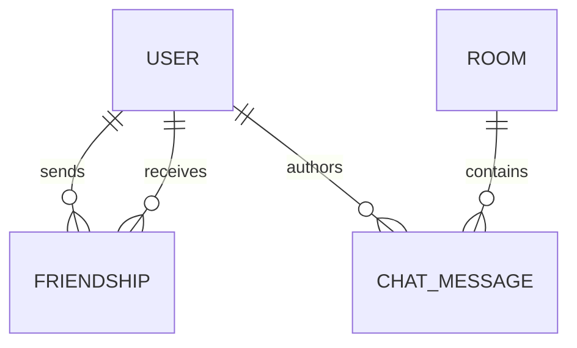

# M2 — Friendships and Room Messages: MCD / MLD

Status: Proposal for review with M5.
Scope: Data design only. M5 owns Prisma models and migrations.

## 1. Existing shared identifiers

- User.id: auto-incrementing Integer.
- Room.id: UUID.
- Existing User and Room models remain the reference.

## 2. Conceptual data model — MCD

### Friendships

A friendship request connects two users:
- One requester sends the request.
- One recipient receives it.
- Each user can send or receive zero to many requests.
- Each request has exactly one requester and one recipient.
- An accepted request represents a mutual friendship.

Proposed lifecycle:
- Creation: PENDING.
- Acceptance by the recipient: ACCEPTED.
- Rejection by the recipient: delete the pending request.
- Cancellation by the requester: delete the pending request.
- Removal by either friend: delete the accepted relationship.

This proposal does not retain rejected or removed relationships.
Blocking users and request history are outside this scope.

### Room messages

- A user can author zero to many messages.
- A room can contain zero to many messages.
- Each message belongs to exactly one room.
- Each message has exactly one author.
- Each message belongs to one channel.

## 3. Logical data model — MLD

### FRIENDSHIP — proposed table: friendships

| Field | Type | Constraints / meaning |
|---|---|---|
| id | Integer | Primary key, auto-increment |
| requesterId | Integer | Required FK → users.id |
| recipientId | Integer | Required FK → users.id |
| status | FriendshipStatus | Required, default PENDING |
| createdAt | DateTime | Required, default current timestamp |
| acceptedAt | DateTime | Nullable; populated when accepted |

Proposed FriendshipStatus values:
- PENDING
- ACCEPTED

Deletion policy:
- Deleting either user deletes the associated friendship rows.
- Both foreign keys use ON DELETE CASCADE.

Database constraints:
1. requesterId must differ from recipientId.
2. Only one relationship may exist per unordered pair of users,
   regardless of status or request direction.
3. PENDING requires acceptedAt IS NULL.
4. ACCEPTED requires acceptedAt IS NOT NULL.

An ordered unique constraint on (requesterId, recipientId) alone
is insufficient: it would allow both A → B and B → A.

Suggested PostgreSQL implementation for unordered uniqueness:
a unique expression index on
LEAST(requesterId, recipientId), GREATEST(requesterId, recipientId).

M5 should implement the equivalent SQL using the actual mapped
column names. CHECK constraints and the expression index should
be included in a versioned migration.

Suggested query indexes:
- (requesterId, status)
- (recipientId, status)

### CHAT_MESSAGE — existing table: chat_messages

| Field | Type | Constraints / meaning |
|---|---|---|
| id | Integer | Primary key, auto-increment |
| roomId | UUID | Required FK → rooms.id |
| userId | Integer | Required FK → users.id |
| channel | ChatChannel | Required; existing enum |
| content | VARCHAR(300) | Required |
| createdAt | DateTime | Required, default current timestamp |

Existing deletion policies:
- Room → messages: ON DELETE CASCADE.
- User → messages: ON DELETE RESTRICT.

Existing indexes:
- (roomId, channel, createdAt)
- (userId)

Keep the existing ChatMessage model and migration.
Do not create a second message table.

ChatChannel values and their visibility rules still need to be
confirmed against the existing enum and the team contract.

## 4. Backend rules

These rules supplement database constraints.

### Friendships

- Derive the acting user's identity from the authenticated session.
- Never trust a requesterId supplied by the client.
- The target user must exist and must differ from the acting user.
- Only the recipient may accept or reject a pending request.
- Only the requester may cancel a pending request.
- Either participant may remove an accepted friendship.
- List accepted friendships from both directions.
- Pending requests do not grant friendship privileges.
- A reverse request must not automatically accept an existing request.
- Handle concurrent requests using the database uniqueness constraint.
- Accept a request only while its status is still PENDING.

### Room messages

- Derive userId from the authenticated identity.
- Verify room membership and channel permissions before sending,
  reading or subscribing to messages.
- Trim message content and reject empty or whitespace-only content.
- Reject content exceeding the agreed 300-character limit.
- Render message content as text in the frontend.
- Do not put game secrets into messages or broadcasts.
- Define message ordering as createdAt, then id, for stable pagination.

## 5. Acceptance criteria for model and migration review

### Friendships

- Self-friendship is rejected by the database.
- Duplicate and reverse-duplicate relationships are rejected.
- Concurrent opposite requests produce at most one relationship.
- References to nonexistent users are rejected.
- The status and acceptedAt consistency constraints are enforced.
- Deleting a user removes their friendship rows.

### Room messages

- References to nonexistent users or rooms are rejected.
- Content longer than 300 characters is rejected by the database.
- Deleting a room removes its messages.
- Deleting a user with messages is blocked under the existing policy.
- Existing messages are preserved when adding friendship support.

### Migrations

- All migrations apply successfully to an empty test database.
- The friendship migration also applies to an existing populated
  test database.
- Previously applied migrations are not rewritten.
- M2 reviews the resulting models and SQL migration.

## 6. Decisions requiring agreement

1. Confirm the request/acceptance friendship workflow.
   This is an M2 proposal, not an already agreed product rule.
2. Confirm ChatChannel values and access rules with the team.
3. Confirm the current message retention policy:
   deleting a room deletes its messages.
4. Confirm ON DELETE RESTRICT for message authors.
   Account deletion will require a separate policy if introduced.

## 7. Ownership and scope

M2:
- Defines and shares the MCD/MLD.
- Confirms functional requirements with the team.
- Reviews M5's Prisma models and migrations.

M5:
- Implements Prisma models and migrations.
- Adds database constraints and indexes.
- Verifies migration execution.

Sprint 3:
- This document and model/migration review are required.
- The friends API is a stretch goal.
- Friends UI, online presence and functional room chat are deferred.